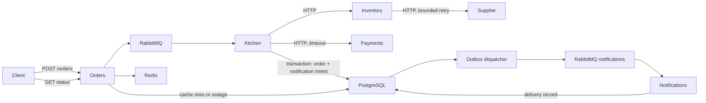

# Where did my order go?

A .NET 10 observability lab with **six applications**, **RabbitMQ, Redis and PostgreSQL**, **OpenTelemetry Collector**, **Aspire Dashboard**, **Prometheus**, **Grafana**, server exporters and alert rules. It runs independently of the original restaurant demo, with separate ports and storage.



Supplier stock and payment authorization are simulated integrations reached through real HTTP calls. Notifications are database delivery records, not actual emails. Messaging, cache commands, SQL, exported telemetry and failure handling are real.

## Quick start

Requires Docker Desktop, .NET 10 and PowerShell 7. From `ThirdPartyObservability`:

```powershell
./run-local.ps1
./rehearse.ps1 -IncludeInfrastructure
```

The launcher starts dependency/monitoring containers, builds the solution, and launches all six applications in the background. Logs and process state are in `.artifacts/`. For infrastructure already running, use `./run-local.ps1 -SkipInfrastructure`.

| Page | Address | Purpose |
| --- | --- | --- |
| Aspire Dashboard | http://localhost:18898 | Distributed traces and correlated logs |
| Grafana | http://localhost:13000/d/restaurant-full | 15 provisioned application/infrastructure panels; anonymous viewer |
| Prometheus | http://localhost:19090 | Queries, targets, rules and firing alerts |
| RabbitMQ | http://localhost:15673 | Queues and dead letters; `demo` / `demo` |
| Orders API | http://localhost:5280 | Menu, scenario names and request instructions |

This solution has an HTTP interface; the original solution's restaurant UI is separate.

## Visual Studio or terminals

Start infrastructure first:

```powershell
docker compose up -d --wait dashboard collector rabbitmq redis postgres prometheus grafana redis-exporter postgres-exporter
```

Open **ThirdPartyObservability.slnx**, select **Third parties: Full restaurant**, and press F5. This starts Orders, Kitchen, Inventory, Supplier, Payments and Notifications. Do not also run the launcher or containerized applications: duplicate workers compete for messages and APIs compete for ports.

For separate terminals, use `dotnet run --project <project>` for each application. The new APIs configure their default ports directly in `Program.cs`.

## Follow one order

```powershell
$order = Invoke-RestMethod http://localhost:5280/orders -Method Post -ContentType application/json -Body '{"dish":"margherita","scenario":"normal"}'
$order # id, queued status and traceId
Invoke-RestMethod "http://localhost:5280/orders/$($order.id)"
Invoke-RestMethod "http://localhost:5280/orders/$($order.id)/notification"
```

Submission returns **202 Queued** after broker confirmation, before kitchen processing completes. Status can initially return 404; retry shortly. Unknown IDs also return 404.

Search the returned `traceId` in Aspire. Service names start with `Zagreb.ThirdParty.`. A normal trace connects:

```text
Orders: POST /orders
  RabbitMQ: restaurant.orders send
    Kitchen: restaurant.orders process
      HTTP POST -> Inventory: POST /availability
        HTTP GET -> Supplier: GET /stock/{dish}
      HTTP POST -> Payments: POST /authorizations
      PostgreSQL: commit order and notification intent
      Outbox: restaurant.notifications send
        Notifications: restaurant.notifications process
          PostgreSQL: record delivery
```

The outbox continues the trace context saved in PostgreSQL, even after the original request ends. Empty outbox polling is suppressed from tracing. Clocks across hosts must be aligned.

Status lookups have separate traces. The first successful lookup shows **Redis GET miss -> PostgreSQL SELECT -> Redis SET**; repeat within 30 seconds for **Redis GET hit**. Order IDs correlate structured logs across these requests, without becoming metric dimensions.

Notification status progresses through `pending`, `dispatched` and `delivered`. Dispatched means broker-confirmed publication, not successful delivery. Notification failures remain dispatched; inspect the notification dead-letter queue.

## Ten scenarios

Use `margherita`, `carbonara` or `risotto` and change the `scenario` field:

| Scenario | Result | What to inspect |
| --- | --- | --- |
| `normal` | accepted, delivered | Full HTTP + messaging + database trace |
| `slow-db` | accepted after about 3 seconds | Real PostgreSQL `SELECT pg_sleep(3)` |
| `fail` | failed, order dead-lettered | Kitchen exception before HTTP integrations |
| `slow-supplier` | accepted after about 2 seconds | Latency in nested Supplier HTTP call |
| `supplier-retry` | accepted | First GET returns 503, second succeeds; retry warning/metric |
| `supplier-down` | failed, order dead-lettered | Two supplier 503s, Inventory 503, kitchen exception |
| `sold-out` | unavailable | Business rejection; Payments is skipped |
| `payment-declined` | declined | HTTP success with `authorized=false` |
| `payment-timeout` | failed, order dead-lettered | Two-second HTTP client timeout |
| `notification-fail` | accepted, notification dead-lettered | Successful order with failed downstream notification |

Only the read-only supplier GET retries, once after 150 ms on 503. Order submissions and payment requests do not retry. Scenario selection is deterministic and request-local.

```powershell
./load.ps1 -Count 60 -Concurrency 6
```

The generator mixes normal, retry, slow-supplier and declined-payment orders, saving IDs in `.artifacts/load.json`. It returns after publication; processing continues asynchronously. Kitchen prefetch is one, so slow work creates visible backlog and message age.

## Dependency outages and backlog

```powershell
docker compose stop redis
# Read an already processed order; PostgreSQL fallback still returns it.
Invoke-RestMethod "http://localhost:5280/orders/$($order.id)"
docker compose start redis
```

A failed Redis GET emits an error span and warning, falls back to PostgreSQL, and skips the SET. Disconnected commands fail promptly; a connected but unresponsive server can still wait for its command timeout.

For backlog demonstrations in **container mode**:

```powershell
docker compose stop kitchen
./load.ps1 -Count 10
docker compose start kitchen

docker compose stop notifications
# Submit normal orders; order processing finishes while notifications queue up.
docker compose start notifications
```

For local applications, stop/restart the relevant worker in Visual Studio instead. Compose controls containers only. The launcher stops all local applications with `./run-local.ps1 -Stop`.

Stop/restart the collector to demonstrate telemetry transport failure without changing order processing. Export queues are finite: long outages can lose telemetry.

`GET /health` is API process liveness. Orders' `GET /health/ready` checks PostgreSQL and its RabbitMQ connection. Redis is optional and excluded. Readiness does not guarantee that Supplier or Payments is healthy; worker startup/failures appear in logs.

## Metrics and alerts

Application signals flow **OTLP -> Collector -> Aspire Dashboard**. The collector also exposes application metrics to Prometheus. Prometheus independently scrapes RabbitMQ's native plugin, Redis exporter and PostgreSQL exporter. Grafana reads Prometheus.

```promql
sum by (service_name, outcome) (restaurant_orders_total)
histogram_quantile(0.95, sum by (le) (rate(restaurant_processing_duration_seconds_bucket[2m])))
rabbitmq_queue_messages_ready
restaurant_http_retries_total
redis_memory_used_bytes
pg_stat_database_numbackends{datname="restaurant"}
```

Message age measures publication-to-consumer-start time; processing duration measures consumer execution. Additional instruments cover notifications, outbox dispatch, cache outcomes, HTTP, runtime and database connection pools. Counters reset on process restart. Generate sufficient traffic before discussing rates or percentiles.

Prometheus rules cover unreachable scrape targets, Redis/PostgreSQL outages, backlog and dead letters. Inspect `/alerts` and `/rules`. Dead-letter alerts remain firing while failed messages exist. No Alertmanager or external paging destination is configured. Scrape-target health does not replace application readiness.

Grafana shows metrics; Aspire provides traces/logs. Aspire telemetry storage is in memory and is lost on dashboard recreation. Prometheus history persists in its named volume.

For temporary detailed OTLP capture:

```powershell
$env:OTEL_DEBUG_VERBOSITY = 'detailed'
docker compose up -d collector
docker compose logs collector
# Restore compact output:
Remove-Item Env:OTEL_DEBUG_VERBOSITY
docker compose up -d collector
```

## Delivery guarantees and demo limits

The kitchen saves the terminal order status and notification intent in **one PostgreSQL transaction**. The outbox locks a pending row with `FOR UPDATE SKIP LOCKED`, publishes using confirms, then marks it dispatched and commits. Broker failures roll back the transaction so intent remains pending. A crash after publication but before commit can publish duplicates; the notification worker deduplicates its database record by order ID.

Durable queues, persistent messages, manual acknowledgements and separate dead-letter queues demonstrate at-least-once delivery behavior, not end-to-end exactly-once transactions. Default classic-queue dead-lettering can lose messages under some broker failures. No automatic replay is included; investigate failures before replaying.

The shared PostgreSQL database and startup `CREATE TABLE IF NOT EXISTS` simplify the lab; production database ownership and migrations are outside its scope. Only terminal order statuses are cached. Existing orders are retained but do not acquire outbox rows retroactively. During a database outage, failed-status persistence can also fail; inspect dead-letter payloads.

Supplier does not reserve stock. Payments never handles cards or moves money. Repeated delivery can repeat simulated HTTP integrations even though SQL writes deduplicate. Production integrations require their own idempotency and compensation policy. Notifications write delivery records without sending real email.

Sample credentials, anonymous dashboards and full trace sampling are for local demonstrations. Published ports bind to loopback. SQL uses parameters; parameter values are not included in SQL text.

## Configuration

| Component | Host port | Override |
| --- | --- | --- |
| Orders | 5280 | `ASPNETCORE_URLS` |
| Inventory | 5281 | `ASPNETCORE_URLS`; Kitchen uses `Inventory__BaseUrl` |
| Supplier | 5282 | `ASPNETCORE_URLS`; Inventory uses `Supplier__BaseUrl` |
| Payments | 5283 | `ASPNETCORE_URLS`; Kitchen uses `Payments__BaseUrl` |
| Collector OTLP | 4327 | `OTEL_EXPORTER_OTLP_ENDPOINT` |
| Aspire UI | 18898 | Compose mapping |
| Prometheus | 19090 | Compose mapping |
| Grafana | 13000 | Compose mapping |
| PostgreSQL | 15432 | `ConnectionStrings__Postgres` |
| Redis | 56379 | `ConnectionStrings__Redis` |
| RabbitMQ AMQP / management | 5673 / 15673 | `RabbitMQ__Uri` / Compose mapping |

## Containers, stopping and reset

To also run the six applications in Docker:

```powershell
./run-local.ps1 -Stop # if you used the launcher
docker compose up -d --build --wait
./rehearse.ps1 -IncludeInfrastructure
```

If Docker builds encounter NuGet `UntrustedRoot` behind a corporate TLS proxy, install your organization's CA in the build image or use the local launcher. Containers need their own certificate trust store. A local build can report NU1900 if NuGet vulnerability data is unreachable; this is distinct from a compilation error.

```powershell
./run-local.ps1 -Stop
docker compose down # retains orders, queues and Prometheus history
# Destructive reset of this solution's data only:
docker compose down -v
```

## Verification and sources

`rehearse.ps1` checks every scenario, eventual statuses, notifications, invalid input, cache consistency and readiness. `-IncludeInfrastructure` also checks five Prometheus targets, application/server metrics, both dead-letter queues, notification deduplication and Grafana provisioning. IDs and trace IDs are saved in `.artifacts/rehearsal.json`. Tests create demo data without clearing existing orders or queues.

Verified with local .NET applications and containerized dependencies: all ten scenarios, duplicate notification handling, all 15 Grafana panel queries, all five Prometheus targets and alert-rule syntax. Detailed OTLP capture confirmed one trace with 18 spans across the six applications, HTTP, SQL and both queues. The local build succeeds with NU1900 audit-network warnings; full Docker application builds remain subject to the NuGet certificate-trust limitation described above.

References: [RabbitMQ .NET](https://www.rabbitmq.com/client-libraries/dotnet-api-guide), [Npgsql diagnostics](https://www.npgsql.org/doc/diagnostics/overview.html), [Redis .NET](https://redis.io/docs/latest/develop/clients/dotnet/), [RabbitMQ monitoring](https://www.rabbitmq.com/docs/monitoring), [Redis exporter](https://github.com/oliver006/redis_exporter), [PostgreSQL exporter](https://github.com/prometheus-community/postgres_exporter). ASP.NET Core, HttpClient and Npgsql spans are automatic; Redis and messaging spans are explicit. The separate RabbitMQ tracing source is not subscribed, avoiding duplicate messaging spans.
