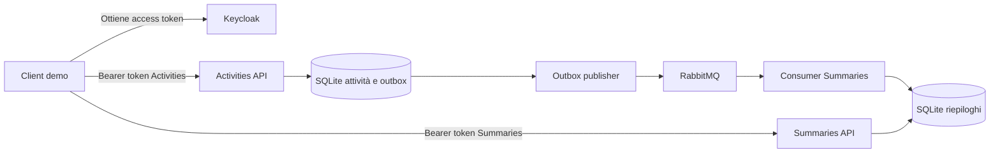

# BabyLog distribuito

Demo API .NET 10 per le domande dopo la sessione. **Activities** registra poppate, cambi e sonno. **Summaries** costruisce un riepilogo per giorno nel fuso `Europe/Rome` a partire dagli eventi pubblicati su RabbitMQ. Keycloak rilascia gli access token OAuth 2.0 per le due API.

## Avvio

Dalla cartella della sessione, con Docker in modalità container Linux e PowerShell 7:

```powershell
docker compose -f Distributed/compose.yaml up --build -d
./Distributed/demo.ps1 -BrokerOutage
```

Lo script attende i servizi, verifica i token, spegne RabbitMQ e registra tre attività. Controlla che il riepilogo resti al valore iniziale durante lo stop e che si aggiorni dopo il riavvio. Elimina poi le tre attività e attende che anche le cancellazioni vengano proiettate. Per la prova con il broker sempre acceso, esegui `./Distributed/demo.ps1`. Per la prova manuale usa [requests.http](requests.http).

| Servizio | Indirizzo | Credenziali demo |
| --- | --- | --- |
| Activities API | `http://127.0.0.1:5180` | `babylog-activities-cli` / `babylog-activities-demo` |
| Summaries API | `http://127.0.0.1:5181` | `babylog-summaries-cli` / `babylog-summaries-demo` |
| Keycloak | [Console](http://localhost:5182/admin/) | `admin` / `babylog-keycloak-demo` |
| RabbitMQ | [Management](http://127.0.0.1:5183/) | `babylog` / `babylog-rabbit-demo` |

Keycloak importa il realm `babylog` al primo avvio. I client usano `client_credentials`, con audience `babylog-activities` e `babylog-summaries`. Il valore di `iss` usa `localhost:5182` anche quando le API leggono discovery e JWKS via `keycloak:8080` sulla rete di Compose. Le porte host sono su loopback, con credenziali fisse e HTTP per la demo locale. [Configurazione hostname di Keycloak](https://www.keycloak.org/server/hostname) · [Validazione JWT in ASP.NET Core](https://learn.microsoft.com/aspnet/core/security/authentication/configure-jwt-bearer-authentication?view=aspnetcore-10.0)

Per fermare i servizi e conservare dati, realm e coda:

```powershell
docker compose -f Distributed/compose.yaml down
```

Per compilare la solution fuori da Docker:

```powershell
dotnet restore Distributed/BabyLog.Distributed.slnx --locked-mode
dotnet build Distributed/BabyLog.Distributed.slnx --no-restore
```

Se il restore dentro BuildKit incontra un certificato aziendale, passa il percorso di un bundle PEM con `BABYLOG_DISTRIBUTED_CA`. Puoi riusare `.artifacts/containers/host-trust.pem` se l’hai già generato per la demo principale. L’override Compose lo monta come secret durante il build.

```powershell
$env:BABYLOG_DISTRIBUTED_CA = 'C:/certs/proxy-ca.pem'
docker compose -f Distributed/compose.yaml -f Distributed/compose.host-trust.yaml up --build -d
```

## Architettura



La [solution](BabyLog.Distributed.slnx) contiene quattro progetti per servizio.

| Progetto | Responsabilità |
| --- | --- |
| `*.Domain` | Modello e regole di dominio. Activities compila la stessa regola di validazione della demo originale. |
| `*.Application` | Casi d’uso e porte di persistenza. Summaries riceve gli eventi tramite i suoi casi d’uso. |
| `*.Infrastructure` | Adapter SQLite, publisher dell’outbox e consumer RabbitMQ. |
| `*.Api` | Adapter HTTP, autenticazione e composizione delle dipendenze. |

`Events` contiene i contratti d’integrazione versionati. `RabbitMq` dichiara l’exchange, i binding e le code. I due servizi scambiano `activity.recorded.v1` e `activity.deleted.v1` tramite il broker. Le note rimangono nel database di Activities.

## Casi da mostrare

- **Consistenza eventuale.** La POST restituisce `201` dopo il commit SQLite di attività e outbox. Il publisher mantiene la riga finché RabbitMQ non conferma. Lo script mostra il ritardo di proiezione con il broker fermo. [RabbitMQ publisher confirms](https://www.rabbitmq.com/tutorials/tutorial-seven-dotnet)
- **Riconsegna.** Il consumer salva la proiezione prima dell’ack. Una riconsegna applica lo stesso risultato grazie alla chiave dell’attività. La cancellazione conserva l’ID e impedisce a un evento di creazione tardivo di ripristinare l’attività.
- **Messaggi non validi.** Nella console RabbitMQ apri **Exchanges → babylog.activities → Publish message** e pubblica il corpo sintetico `{}` con routing key `activity.recorded.v1`. Il consumer lo rifiuta. Il messaggio compare in `babylog.summaries.dead` sotto **Queues and Streams**.
- **Token per due risorse.** Una richiesta senza token riceve `401`. Il token per Activities riceve `401` anche su Summaries, dove l’audience richiesta è diversa.

La demo usa un publisher per outbox e un volume SQLite per servizio. Il broker conserva i messaggi ancora in consegna, mentre l’outbox elimina quelli già confermati. Per ricostruire la proiezione dopo la perdita del suo database servirebbe una sorgente di replay o una procedura di riconciliazione.

## SBOM, CVE e Dependency-Track

Dalla cartella della sessione, genera una SBOM SPDX 2.2 del publish, una CycloneDX 1.6 delle dipendenze NuGet e un report NuGet Audit per servizio. Gli artefatti finiscono in `.artifacts/distributed-supply-chain/`. Il manifest riporta conteggi, esito della validazione SPDX e hash delle SBOM CycloneDX.

```powershell
./Distributed/supply-chain.ps1
```

Con le quattro immagini già disponibili in Docker, `-Images` aggiunge un inventario CycloneDX e un report Trivy per ogni immagine. Per analizzare anche il publish direttamente con Trivy nativo, passa `-TrivyPath <percorso-eseguibile>`. La scansione del publish usa la cache Trivy in `.artifacts/trivy-cache`. Il file `trivy-db-metadata.json` indica la data del database usato.

```powershell
docker compose -f Distributed/compose.yaml build activities summaries
docker compose -f Distributed/compose.yaml pull rabbitmq keycloak
./Distributed/supply-chain.ps1 -Images
```

[Avvia Dependency-Track](../docs/dependency-track.md) e usa `-Upload` per importare le SBOM in progetti dedicati. Per lo standalone su Windows:

```powershell
./scripts/start-dependency-track.ps1 -Standalone -UseLocalOsvSnapshot
./scripts/bootstrap-dependency-track.ps1 -Standalone -UseLocalOsvSnapshot
./Distributed/supply-chain.ps1 -Upload -DependencyTrackUrl http://127.0.0.1:8190 -CredentialsPath .secrets/dependency-track-standalone.json
```

Nel **Portfolio** cerca `BabyLog.Distributed/activities` o `BabyLog.Distributed/summaries`, versione `1.0.0`. **Components** mostra l’inventario, **Audit** mostra i finding di Dependency-Track. Trivy registra i finding OS e applicativi dei container nei report JSON. [Analisi Trivy dei pacchetti .NET](https://trivy.dev/docs/latest/guide/coverage/language/dotnet/)
